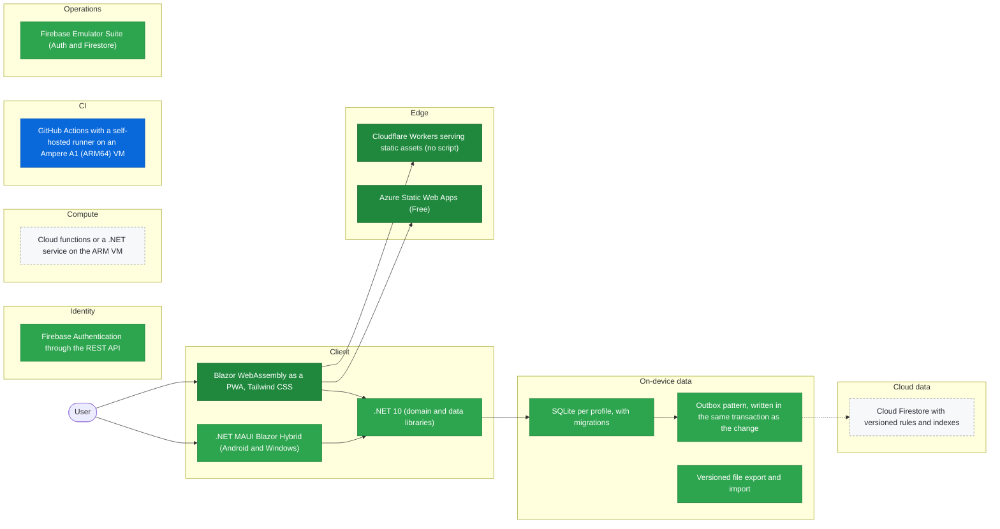

# Multi-Cloud SaaS Architecture: High Availability and FinOps

The reference architecture of an early-production SaaS that **runs at zero infrastructure cost** and **keeps working without a network**. It shows the real topology, the cost guardrails applied on each cloud, the architecture decisions with the reason for each one, and the testing strategy.

> **Note:** the business logic and the product live in a private repository. Everything here was extracted from verified facts of the real project (`facts/`), without account identifiers or business rules. No number on this page is a marketing estimate: each one has its measurement method next to it.

<!-- generated:updated:start -->
Facts as of 2026-11-02 (package v6).
<!-- generated:updated:end -->

## At a glance

<!-- generated:glance:start -->
| What | Value | How it was obtained |
|---|---|---|
| Architecture decisions recorded | 10 | One file per decision in [`docs/adr/`](docs/adr/), with context, decision, consequences and alternatives |
| Automated test cases | 1,531 | Sum of the 7 suites in [Quality](#quality) |
| first visit to the web app | 4.08 MB (brotli) | Measured in the browser: about 80 requests |
| repeat visit with the service worker | 7 KB | Measured in the browser |
| active users that fit in SWA Free | 7,800 MAU | 100 GB/month divided by the bandwidth per user |
| post-publish verification of production | 20 of 20 items | Script in a clean browser against the production web app: service worker in control, full cache and offline open, among others |
<!-- generated:glance:end -->

**Start here**

- [ADR 0003: zero-cost guardrails as code](docs/adr/0003-zero-cost-guardrails.md): how a misconfiguration is denied instead of billed.
- [ADR 0006: backend only with measured demand](docs/adr/0006-backend-on-demand.md): why there is no application server yet.
- [ADR 0009: production ships only by manual dispatch](docs/adr/0009-production-by-manual-dispatch-only.md): how a release reaches production.
- [All decisions](docs/adr/README.md), each with its alternatives considered.

## Topology

<!-- generated:diagram:start -->

Solid line: in use. Dashed: reserve, evaluated or planned.
<!-- generated:diagram:end -->

## How high availability is achieved here

There is no cluster to keep alive. Availability comes from three choices:

1. **Offline-first:** the app (native or Web) writes to a local database and works without a network. A cloud outage does not interrupt use. Changes wait in an outbox until they can be sent.
2. **A static edge with no request limit:** the Web app is a set of static files served by the Cloudflare edge. Azure Static Web Apps, already configured, is the beta environment and the production fallback.
3. **No application server of our own** until there is measured demand (see [ADR 0006](docs/adr/0006-backend-on-demand.md)).

## From problem to results

- **Problem.** A SaaS that must work on unreliable networks and cost nothing to run before it has revenue.
- **Constraints.** Pay-as-you-go accounts on several providers, two of which do not accept a spending cap, and free allowances that a provider can reduce.
- **Decisions.** The device holds the data and the cloud only syncs ([ADR 0001](docs/adr/0001-offline-first-no-server.md)). The web app is static files on an edge with no request charge ([ADR 0002](docs/adr/0002-static-hosting-on-cloudflare.md)). Each cloud gets a guardrail as code ([ADR 0003](docs/adr/0003-zero-cost-guardrails.md)). A server waits for measured demand ([ADR 0006](docs/adr/0006-backend-on-demand.md)). Every release is verified the way a client sees it ([ADR 0008](docs/adr/0008-post-publish-verification.md)) and production ships only by manual dispatch ([ADR 0009](docs/adr/0009-production-by-manual-dispatch-only.md)).
- **Results.** The numbers are in [At a glance](#at-a-glance) and in [Measurements](#measurements), each with how it was obtained. The production verification passes every item of its script.

## Components

<!-- generated:components:start -->
| Layer | Technology | Role | State |
|---|---|---|---|
| Client | .NET 10 (domain and data libraries) | Business rules and data access in a single codebase, shared by the native app and the web app | 🟢 implemented |
| Client | .NET MAUI Blazor Hybrid (Android and Windows) | Installed app; same Razor UI as the web app | 🟢 implemented |
| Client | Blazor WebAssembly as a PWA, Tailwind CSS | Same app in the browser, with a service worker for offline use | 🟢 published |
| On-device data | SQLite per profile, with migrations | Source of truth on the device; the app works without a network | 🟢 implemented |
| On-device data | Outbox pattern, written in the same transaction as the change | Local queue of changes, ready to be sent to the cloud | 🟢 implemented |
| On-device data | Versioned file export and import | Protects user data until sync exists | 🟢 implemented |
| Identity | Firebase Authentication through the REST API | Account, session and app lock (with on-device biometrics) | 🟢 implemented |
| Cloud data | Cloud Firestore with versioned rules and indexes | Target of upload sync and, later, of device-to-device download sync | ⚪ planned |
| Edge | Cloudflare Workers serving static assets (no script) | Primary hosting for the web app and the landing page, with security headers generated at deploy time | 🟢 published |
| Edge | Azure Static Web Apps (Free) | Beta environment for the web app, fallback for production, and the previous landing page until the switch | 🟢 published |
| CI | GitHub Actions with a self-hosted runner on an Ampere A1 (ARM64) VM | Build, tests and deploy without spending paid minutes | 🔵 evaluated |
| Compute | Cloud functions or a .NET service on the ARM VM | Sign out of all devices and delete an account with all its data | ⚪ planned |
| Operations | Firebase Emulator Suite (Auth and Firestore) | Default target for development and integration tests | 🟢 implemented |
<!-- generated:components:end -->

## Clouds and services

<!-- generated:clouds:start -->
#### Cloudflare

> Only resources with no charge: requests to static assets have no cost and no limit.

| Service | SKU | Region | Role | State |
|---|---|---|---|---|
| Workers (static assets) | Free | — | Primary hosting for the web app | 🟢 published |
| Workers (static assets) | Free | — | Landing page site | 🟢 published |

#### Microsoft Azure

> Zero spend: Free SKUs only. A pay-as-you-go subscription does not accept a spending cap, so the protection is to deny anything that is not Free.

| Service | SKU | Region | Role | State |
|---|---|---|---|---|
| Static Web Apps | Free | East US 2 | Beta environment for the web app, fallback for production, and the previous landing page site until the switch to Cloudflare | 🟢 published |
| App Service | F1 (Linux) | — | Previous resource, unused | ⚫ legacy |

#### Oracle Cloud (OCI)

> Zero spend: Always Free only, in the home region. A tenancy quota blocks anything beyond that and a budget alerts on any charge.

| Service | SKU | Region | Role | State |
|---|---|---|---|---|
| Compute Ampere A1 (VM.Standard.A1.Flex) | Always Free | sa-saopaulo-1 | ARM64 CI runner and, if demand requires it, a minimal server | 🟡 in test |
| Block Volume | Always Free | — | VM boot disk (50 of 200 GB in use) | 🟡 in test |

#### Google Cloud / Firebase

> Zero spend on the Blaze plan: usage stays below the no-cost quota. Google has no limit that blocks spend, only budget alerts.

| Service | SKU | Region | Role | State |
|---|---|---|---|---|
| Firebase Authentication | Blaze (no-cost quota) | — | Identity | 🟢 implemented |
| Cloud Firestore | Blaze (no-cost quota) | southamerica-east1 | Sync | ⚪ planned |
| Cloud Build | Free | — | x64 Android build, which does not run on the ARM runner | 🔵 evaluated |
| Firebase (beta environment project) | Spark (no billing) | — | Beta environment identity, separate from production | 🟢 published |
| Cloud Run | — | — | Backend of a previous version | ✖️ discarded |
<!-- generated:clouds:end -->

## FinOps: zero cost as code

Each cloud has a guardrail that **blocks** anything paid where the provider allows it, and an alert where it does not. That is the differentiator of this architecture: a misconfiguration is denied instead of billed. The files are in [`finops/`](finops/), ready to apply with the providers' own CLIs.

- **Azure:** a policy denies any SKU that is not Free, and a deployment validation proved it.
- **Oracle Cloud:** a tenancy quota allows only the Always Free A1 shape, and a budget alerts on any charge. A test with a larger A1 allocation is in progress; the rule may change when the test ends.
- **Firebase:** the beta environment runs on a project without billing, so it stops at the quota instead of billing.
- **Google Cloud:** the billing plan has no spend block, so the protection is a budget alert, plus choices that keep usage inside the no-cost quota.
- **Cloudflare:** static assets are not billed per request.

<!-- generated:protections:start -->
| Cloud | Type | Protection | State | File |
|---|---|---|---|---|
| Cloudflare | no-overage-sku | Static assets are not billed per request | active | — |
| Microsoft Azure | policy | An Azure Policy at subscription scope denies Static Web Apps and App Service plans that are not Free (verified: Deployment validation: Standard and B1 denied, Free accepted) | active | [finops/azure/free-sku-only-policy.json](finops/azure/free-sku-only-policy.json) |
| Oracle Cloud (OCI) | quota | A tenancy quota zeroes compute and block storage and allows only the free A1, including the regional count. During the test, the applied quota allows 4 OCPUs and 24 GB on the A1 and, at that value, does not block the 1,500 OCPU-hour overage; the budget is what warns about cost (verified: resource-availability shows only the A1 available; other shapes at 0) | active | [finops/oci/free-tier-only-quota.txt](finops/oci/free-tier-only-quota.txt) |
| Oracle Cloud (OCI) | budget | Monthly budget of 1 unit of the tenancy currency with an alert from 0.01 of actual spend | active | [finops/oci/budget.json](finops/oci/budget.json) |
| Oracle Cloud (OCI) | alert | A notice at the start of every work session with the deadline and the cost checks of the 4-OCPU test, until the VM is stopped | active | — |
| Google Cloud / Firebase | budget | Monthly budget of BRL 1 filtered to the app's project, with alerts at 1%, 50% and 100% | active | — |
| Google Cloud / Firebase | no-overage-sku | The beta environment uses a Firebase project on the Spark plan: when it hits the quota it stops instead of billing | active | — |
<!-- generated:protections:end -->

### Measurements

<!-- generated:measurements:start -->
| Measurement | Value | How |
|---|---|---|
| first visit to the web app | 4.08 MB (brotli) | Measured in the browser: about 80 requests |
| repeat visit with the service worker | 7 KB | Measured in the browser |
| bandwidth per active user | 12.8 MB/month | Estimated: every release invalidates all files (same ETag) |
| share of bandwidth caused by updates | 64 % | Estimated from the bandwidth per user and the release frequency |
| active users that fit in SWA Free | 7,800 MAU | 100 GB/month divided by the bandwidth per user |
| web publish on the ARM runner | 45 s | Measured on the A1 VM |
| .NET tests on the ARM runner | 977 passing tests | Point-in-time count from the ARM runner evaluation (ADR 0004), run on the A1 VM (.NET 10 and wasm-tools require libatomic1). The current counts per suite are in the Quality section |
| A1 usage in October (4-OCPU VM since Oct 25) | 600.48 OCPU-hours | Read from the month's cost report: below both possible limits (1,500 and 3,000), zero cost. In November, running the whole month, the VM would consume 2,880 OCPU-hours |
| publish to Cloudflare | 1 min | Measured with the build on the developer PC |
| files uploaded in an incremental publish | 10 of 78 files | Measured in the Wrangler upload: only changed files are sent |
| internationalization data file on Cloudflare | 331 KB (zstd) | Measured in the browser on a temporary Worker: the 1.1 MB file started being compressed once served as application/wasm; the app opened, including offline. Still to repeat on the Azure beta |
| post-publish verification of production | 20 of 20 items | Script in a clean browser against the production web app: service worker in control, full cache and offline open, among others |

Operational limit: alert at **80%** of each free quota.

Reevaluation triggers:
- Web above 80 GB/month: reevaluate a CDN from another provider
- Firestore near 40 thousand reads/day: reevaluate the cloud database
- Compute charge on OCI during the A1 test: go back to 2 OCPUs and 12 GB
<!-- generated:measurements:end -->

## Quality

<!-- generated:quality:start -->
| Suite | Tool | Target | Count |
|---|---|---|---|
| Core unit and integration | xUnit | .NET | 596 |
| Integration against the emulator | xUnit + Firebase Auth Emulator | .NET | 5 |
| Razor components | bUnit | .NET | 514 |
| Process automation scripts | node:test | Node | 288 |
| End-to-end on the web | Playwright | Web at 3 widths (phone, tablet, desktop) | 117 |
| End-to-end on the Windows app | Playwright over CDP on WebView2 | Windows | 3 |
| Layout audit on Android | Playwright + adb over USB | Real Android device | 8 |

- TDD: the test fails for the right reason before the implementation
- Service worker tested end to end: returns to the app from the cache and opens offline
- Every release checked by script the way a client would see it: headers, wasm type, environment, second visit, service worker cache and offline open
- Third-party actions pinned to the full commit SHA, not to a tag
- Git pre-commit hook that scans the staged content and blocks a secret before the commit exists
- Production published only by manual dispatch, with a typed confirmation and only commits that already passed a green beta

All practices: [docs/engineering.md](docs/engineering.md).
<!-- generated:quality:end -->

## Engineering process

<!-- generated:process:start -->
- Every delivery goes through specification, plan, TDD execution, independent review and fixes with tests
- This showcase is updated from a sanitized fact package: the README data blocks and the ADRs are generated by script, and CI (facts, leaks, secrets and SonarQube Cloud) blocks any PR that fails

The full process: [docs/engineering.md](docs/engineering.md).
<!-- generated:process:end -->

## Architecture decisions

The decisions and the context of each one are in [`docs/adr/`](docs/adr/README.md), with the alternatives considered where the record has them.

## Roadmap

<!-- generated:roadmap:start -->
| Item | State | Condition |
|---|---|---|
| Custom domain: production on Cloudflare and Azure back to fallback, switched through DNS | ⚪ planned | — |
| CI with GitHub Actions on the ARM runner: build, tests, per-branch preview and production on Cloudflare | ⚪ planned | — |
| Upload sync (outbox to Firestore) with rules tested on the emulator | ⚪ planned | — |
| Device-to-device download sync with a conflict rule | ⚪ planned | — |
| Minimal server: Functions or .NET on the ARM VM | ⚪ planned | Depends on the estimated client count and on equal or better performance |
| Containerized APIs on OCI behind a Cloudflare Tunnel, admin access over Tailscale, PostgreSQL and Redis | ⚪ planned | Original topology of this showcase; enters once there is a backend with measured load |
| AWS and Alibaba Cloud | ✖️ discarded | Reevaluate at the finops triggers |
<!-- generated:roadmap:end -->

The original topology of this showcase (containerized APIs on OCI, Cloudflare Tunnel, Tailscale, PostgreSQL and Redis) remains **planned** and is detailed in [`docs/roadmap.md`](docs/roadmap.md).

## How this repository works

The data on this page is generated from a sanitized fact package and checked by CI. The details are in [`docs/how-this-repo-works.md`](docs/how-this-repo-works.md).

## Author

**Marcelo Ricarte Besteti**: Software & Cloud Engineer

Architecture, development and support of distributed systems, combining full-stack development, infrastructure engineering and cost optimization.

[LinkedIn](https://www.linkedin.com/in/marcelo-ricarte-besteti-86a94069/)
