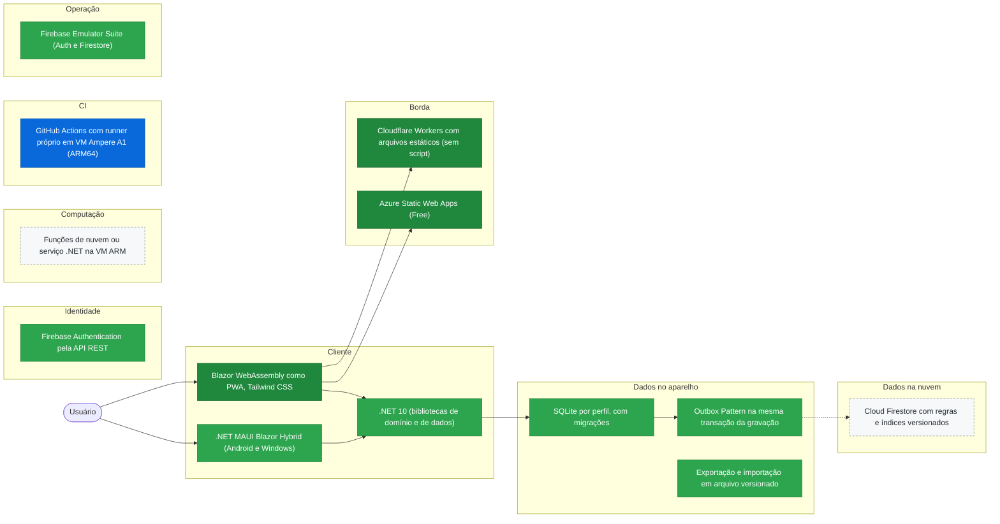

# 🚀 Multi-Cloud SaaS Architecture: High-Availability & FinOps Boilerplate

Esta é a arquitetura de referência de um SaaS em produção inicial, desenhado para **operar sem custo de infraestrutura** e **continuar funcionando sem rede**. O repositório mostra a topologia real, as proteções de custo aplicadas em cada nuvem, as decisões de arquitetura com o motivo de cada uma e a estratégia de testes.

> **Nota:** a lógica de negócio e o produto ficam em repositório privado. Tudo o que está aqui foi extraído de fatos verificados do projeto real (`fontes/`), sem identificadores de contas nem regras de negócio. Nenhum número desta página é estimativa de marketing: cada um tem a forma de medição ao lado.

<!-- gerado:atualizado:inicio -->
Fatos de 2026-10-25 (pacote v3).
<!-- gerado:atualizado:fim -->

---

## Como a alta disponibilidade é obtida aqui

Não há um cluster para manter de pé. A disponibilidade vem de três escolhas:

1. **Offline-first:** o app (nativo ou Web) grava num banco local e funciona sem rede. Uma falha da nuvem não interrompe o uso. As alterações ficam numa outbox até poderem ser enviadas.
2. **Borda estática sem limite de requisições:** a Web é um conjunto de arquivos estáticos servido pela borda da Cloudflare. O Azure Static Web Apps, já configurado, é o ambiente beta e a reserva da produção.
3. **Nenhum servidor de aplicação próprio** até haver demanda medida (ver [ADR 0006](docs/adr/0006-backend-sob-demanda.md)).

## Topologia

<!-- gerado:diagrama:inicio -->

Linha cheia: em uso. Tracejada: reserva, avaliado ou planejado.
<!-- gerado:diagrama:fim -->

<!-- gerado:componentes:inicio -->
| Camada | Tecnologia | Papel | Estado |
|---|---|---|---|
| Cliente | .NET 10 (bibliotecas de domínio e de dados) | Regras de negócio e acesso a dados num só código, usado pelo app nativo e pela Web | 🟢 implementado |
| Cliente | .NET MAUI Blazor Hybrid (Android e Windows) | App instalado; mesmas telas Razor da Web | 🟢 implementado |
| Cliente | Blazor WebAssembly como PWA, Tailwind CSS | Mesmo app no navegador, com service worker para uso offline | 🟢 publicado |
| Dados no aparelho | SQLite por perfil, com migrações | Fonte da verdade no aparelho; o app funciona sem rede | 🟢 implementado |
| Dados no aparelho | Outbox Pattern na mesma transação da gravação | Fila local de alterações, pronta para o envio à nuvem | 🟢 implementado |
| Dados no aparelho | Exportação e importação em arquivo versionado | Proteção dos dados antes de haver sincronização | 🟢 implementado |
| Identidade | Firebase Authentication pela API REST | Conta, sessão e bloqueio do app (com biometria no aparelho) | 🟢 implementado |
| Dados na nuvem | Cloud Firestore com regras e índices versionados | Destino da sincronização de envio e, depois, do recebimento entre aparelhos | ⚪ planejado |
| Borda | Cloudflare Workers com arquivos estáticos (sem script) | Hospedagem principal da Web e do site da landing page, com cabeçalhos de segurança gerados no deploy | 🟢 publicado |
| Borda | Azure Static Web Apps (Free) | Ambiente beta da Web, reserva da produção e o site anterior da landing page até a troca | 🟢 publicado |
| CI | GitHub Actions com runner próprio em VM Ampere A1 (ARM64) | Build, testes e deploy sem consumir minutos pagos | 🔵 avaliado |
| Computação | Funções de nuvem ou serviço .NET na VM ARM | Encerrar sessões em todos os aparelhos e excluir conta com todos os dados | ⚪ planejado |
| Operação | Firebase Emulator Suite (Auth e Firestore) | Alvo padrão de desenvolvimento e dos testes de integração | 🟢 implementado |
<!-- gerado:componentes:fim -->

## Nuvens e serviços

<!-- gerado:nuvens:inicio -->
#### Cloudflare

> Só recursos sem cobrança: requisições a arquivos estáticos não têm custo nem limite.

| Serviço | SKU | Região | Papel | Estado |
|---|---|---|---|---|
| Workers (arquivos estáticos) | Free | — | Hospedagem principal da Web | 🟢 publicado |
| Workers (arquivos estáticos) | Free | — | Site da landing page | 🟢 publicado |

#### Microsoft Azure

> Gasto zero: só SKU Free. Assinatura paga por uso não aceita teto de gasto, então a proteção é negar o que não for Free.

| Serviço | SKU | Região | Papel | Estado |
|---|---|---|---|---|
| Static Web Apps | Free | East US 2 | Ambiente beta da Web, reserva da produção e o site anterior da landing page até a troca para a Cloudflare | 🟢 publicado |
| App Service | F1 (Linux) | — | Recurso anterior, sem uso | ⚫ legado |

#### Oracle Cloud (OCI)

> Gasto zero: só Always Free, na região principal. Uma cota de tenancy bloqueia o que passa disso e um orçamento avisa de qualquer cobrança.

| Serviço | SKU | Região | Papel | Estado |
|---|---|---|---|---|
| Compute Ampere A1 (VM.Standard.A1.Flex) | Always Free | sa-saopaulo-1 | Runner de CI ARM64 e, se a demanda pedir, servidor mínimo | 🟡 em teste |
| Block Volume | Always Free | — | Disco de boot da VM | 🟡 em teste |

#### Google Cloud / Firebase

> Gasto zero no plano Blaze: o uso fica abaixo da cota sem custo; o Google não tem limite que bloqueie gasto, só alerta de orçamento.

| Serviço | SKU | Região | Papel | Estado |
|---|---|---|---|---|
| Firebase Authentication | Blaze (cota sem custo) | — | Identidade | 🟢 implementado |
| Cloud Firestore | Blaze (cota sem custo) | southamerica-east1 | Sincronização | ⚪ planejado |
| Cloud Build | Gratuito | — | Build x64 do Android, que não roda no runner ARM | 🔵 avaliado |
| Firebase (projeto do ambiente beta) | Spark (sem faturamento) | — | Identidade do ambiente beta, separada da produção | 🟢 publicado |
| Cloud Run | — | — | Backend de uma versão anterior | ✖️ descartado |
<!-- gerado:nuvens:fim -->

## FinOps: custo zero como código

Cada nuvem tem uma proteção que **bloqueia** o que for pago, onde o provedor permite, e um alerta onde não permite. Os arquivos estão em [`finops/`](finops/), prontos para aplicar com os próprios CLIs dos provedores.

<!-- gerado:protecoes:inicio -->
| Nuvem | Tipo | Proteção | Estado | Arquivo |
|---|---|---|---|---|
| Cloudflare | sku-sem-excedente | Arquivos estáticos não são cobrados por requisição | ativa | — |
| Microsoft Azure | policy | Azure Policy no escopo da assinatura nega Static Web Apps e planos do App Service fora do Free (conferido: Validação de implantação: Standard e B1 negados, Free aceito) | ativa | [finops/azure/politica-somente-free.json](finops/azure/politica-somente-free.json) |
| Oracle Cloud (OCI) | quota | Cota de tenancy zera compute e block storage e libera só o A1 gratuito, inclusive a contagem regional (conferido: resource-availability mostra só o A1 disponível; outras formas em 0) | ativa | [finops/oci/cota-somente-gratuito.txt](finops/oci/cota-somente-gratuito.txt) |
| Oracle Cloud (OCI) | budget | Orçamento mensal de 1 com alerta a partir de 0,01 de gasto real | ativa | [finops/oci/orcamento.json](finops/oci/orcamento.json) |
| Google Cloud / Firebase | budget | Orçamento mensal de R$ 1 filtrado para o projeto do app, com alertas em 1%, 50% e 100% | ativa | — |
| Google Cloud / Firebase | sku-sem-excedente | O ambiente beta usa um projeto Firebase no plano Spark: ao bater a cota, ele para em vez de cobrar | ativa | — |
<!-- gerado:protecoes:fim -->

### Medições

<!-- gerado:medicoes:inicio -->
| Medição | Valor | Como |
|---|---|---|
| primeira visita à Web | 4,08 MB (brotli) | Medido no navegador: cerca de 80 requisições |
| visita repetida com service worker | 7 KB | Medido no navegador |
| banda por usuário ativo | 12,8 MB/mês | Estimado: cada publicação invalida todos os arquivos (mesmo ETag) |
| parte da banda que vem das atualizações | 64 % | Estimado a partir da banda por usuário e da frequência de publicação |
| usuários ativos que cabem no SWA Free | 7.800 MAU | 100 GB/mês divididos pela banda por usuário |
| publish da Web no runner ARM | 45 s | Medido na VM A1 |
| testes .NET no runner ARM | 977 testes verdes | Rodados na VM A1 (.NET 10 e wasm-tools exigem a libatomic1) |
| publicação na Cloudflare | 1 min | Medido com o build no PC |
| arquivos enviados numa publicação incremental | 10 de 78 arquivos | Medido no envio do Wrangler: só os arquivos mudados sobem |
| verificação pós-publicação da produção | 20 de 20 itens | Script num navegador limpo contra a Web de produção: service worker controlando, cache completo e abertura sem rede, entre outros |

Limite operacional: alerta em **80%** de cada cota gratuita.

Gatilhos de reavaliação:
- Web acima de 80 GB/mês: reavaliar CDN de outro provedor
- Firestore perto de 40 mil leituras/dia: reavaliar o banco na nuvem
- Cobrança de compute na OCI durante o teste do A1: voltar para 2 OCPU e 12 GB
<!-- gerado:medicoes:fim -->

## Qualidade

<!-- gerado:qualidade:inicio -->
| Suíte | Ferramenta | Alvo | Quantidade |
|---|---|---|---|
| Unidade e integração do núcleo | xUnit | .NET | 584 |
| Integração contra emulador | xUnit + Firebase Auth Emulator | .NET | 5 |
| Componentes Razor | bUnit | .NET | 433 |
| Ponta a ponta na Web | Playwright | Web em 3 larguras (celular, tablet, desktop) | 83 |
| Ponta a ponta no app Windows | Playwright via CDP no WebView2 | Windows | 3 |
| Auditoria de layout no Android | Playwright + adb pelo USB | Android real | 8 |

- TDD: o teste falha pelo motivo certo antes da implementação
- Avisos de compilação tratados como erro; documentação XML exigida no CI
- Cabeçalhos de segurança e CSP testados no ponta a ponta
- Service worker testado no ponta a ponta: volta ao app pelo cache e abertura sem rede
- Service worker endurecido contra resposta redirecionada da borda, com redirecionamento simulado no ponta a ponta
- Cada publicação conferida por script como um cliente a veria: cabeçalhos, tipo do wasm, ambiente, segunda visita, cache do service worker e abertura offline
- Quality gate do SonarQube Cloud nos pull requests
- Firebase local (emuladores) como alvo padrão; o projeto real só quando o emulador não responde
- Documentação por arquivo num espelho da árvore, com invariantes e motivos, não assinaturas
<!-- gerado:qualidade:fim -->

## Processo de engenharia

<!-- gerado:processo:inicio -->
- Cada entrega passa por especificação, plano, execução com TDD, revisão independente e correções com teste
- Achados menores de revisão ficam registrados com dono e momento de resolver
- Desenvolvimento assistido por agentes especializados por camada (domínio, dados, interface, hosts, e2e, revisão, depuração, pesquisa em documentação, nuvem)
- Cada agente tem modelo e nível de esforço definidos pelo tipo de trabalho, e uma orquestração decide o que roda em paralelo e como avaliar o que volta
- Esta vitrine é atualizada por um pacote de fatos saneado, um agente que escreve (Jules) e um revisor automático (regras, SonarQube Cloud e Claude) que aprova ou devolve o PR
- Cada nuvem tem um arquivo de cotas gratuitas versionado, conferido com a fonte oficial e com limite operacional de 80%
- A operação das nuvens (publicar, conferir recursos, custos e cotas) passa por um agente de infraestrutura chamado pela sessão principal, com verificações obrigatórias e as armadilhas já vividas registradas
<!-- gerado:processo:fim -->

## Decisões de arquitetura

As decisões e o contexto de cada uma estão em [`docs/adr/`](docs/adr/).

## Roteiro

<!-- gerado:roteiro:inicio -->
| Item | Estado | Condição |
|---|---|---|
| Domínio próprio: produção na Cloudflare e o Azure de volta a reserva, com troca pelo DNS | ⚪ planejado | — |
| CI com GitHub Actions no runner ARM: build, testes, preview por branch e produção na Cloudflare | ⚪ planejado | — |
| Sincronização de envio (outbox para o Firestore) com regras testadas no emulador | ⚪ planejado | — |
| Recebimento entre aparelhos com regra de conflito | ⚪ planejado | — |
| Servidor mínimo: Functions ou .NET na VM ARM | ⚪ planejado | Depende da estimativa de clientes e de desempenho igual ou melhor |
| APIs em contêineres na OCI atrás de Cloudflare Tunnel, acesso administrativo por Tailscale, PostgreSQL e Redis | ⚪ planejado | Topologia original desta vitrine; entra quando houver backend com carga medida |
| AWS e Alibaba Cloud | ✖️ descartado | Reavaliar nos gatilhos de finops |
<!-- gerado:roteiro:fim -->

A topologia original desta vitrine (APIs em contêineres na OCI, Cloudflare Tunnel, Tailscale, PostgreSQL e Redis) continua como **planejada** e está detalhada em [`docs/roteiro.md`](docs/roteiro.md).

## Como esta vitrine se mantém atualizada

1. O projeto privado gera um pacote de fatos saneado (`fontes/estado.json` e `fontes/decisoes/`). Um verificador local roda antes do push.
2. O pacote entra por pull request com a etiqueta `fatos-vitrine`. O CI bloqueia identificadores (GUID, OCID, IP, e-mail, hostnames de provedor, chaves) e uma lista de termos proibidos que fica num secret, nunca no repositório.
3. Quando esse PR é aceito, uma issue com a etiqueta `jules` aciona o agente [Jules](https://jules.google), que atualiza o README, os ADRs e `finops/` seguindo o [`AGENTS.md`](AGENTS.md) e abre um novo PR, que passa pelo mesmo CI.

## Autor

**Marcelo Ricarte Besteti**: Software & Cloud Engineer

Arquitetura, desenvolvimento e sustentação de sistemas distribuídos, unindo desenvolvimento full-stack, engenharia de infraestrutura e otimização de custos.

🔗 [LinkedIn](https://www.linkedin.com/in/marcelo-ricarte-besteti-86a94069/)
