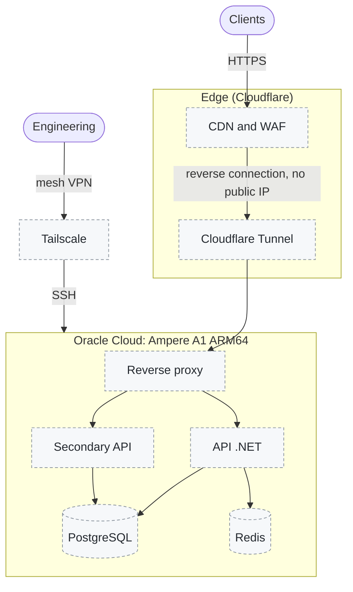

# Roadmap: planned backend topology

This was the original topology of this showcase. It stays **planned** and only enters when there is a backend with measured load ([ADR 0006](adr/0006-backend-on-demand.md)). Until then, no capacity claim (RPS, SLA) is made.

## Conditions to enter

- **Capacity:** the free A1 dropped to 2 OCPU and 12 GB in 2026 (a test is under way to find out whether paid accounts keep 4 and 24). The supported load will be measured with a load test before any number goes into the README.
- **Access:** today, VM access is by SSH with a dedicated key, allowed only for a single /32. Tailscale replaces that rule when there is more than one operator.
- **No public IP:** Cloudflare Tunnel comes in together with the first exposed API.
- **Data:** PostgreSQL and Redis only if the minimal server (cloud functions or .NET on the VM) is not enough.
