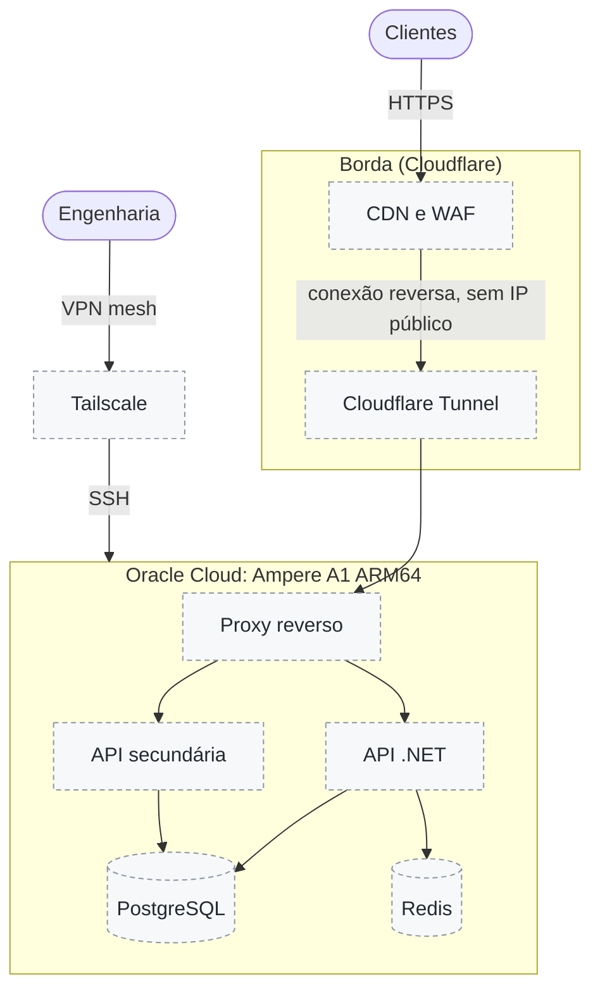

# Roteiro: topologia de backend planejada

Esta foi a topologia original desta vitrine. Ela fica **planejada** e só entra quando houver um backend com carga medida ([ADR 0006](adr/0006-backend-sob-demanda.md)). Até lá, nenhuma afirmação de capacidade (RPS, SLA) é feita.

## Condições para entrar

- **Capacidade:** o A1 gratuito caiu para 2 OCPU e 12 GB em 2026 (há um teste em andamento para saber se contas pagas mantêm 4 e 24). A carga suportada será medida com teste de carga antes de qualquer número ir para o README.
- **Acesso:** hoje o acesso à VM é por SSH com chave dedicada, liberado só para um /32. O Tailscale substitui essa regra quando houver mais de um operador.
- **Sem IP público:** o Cloudflare Tunnel entra junto com a primeira API exposta.
- **Dados:** PostgreSQL e Redis só se o servidor mínimo (funções de nuvem ou .NET na VM) não bastar.
